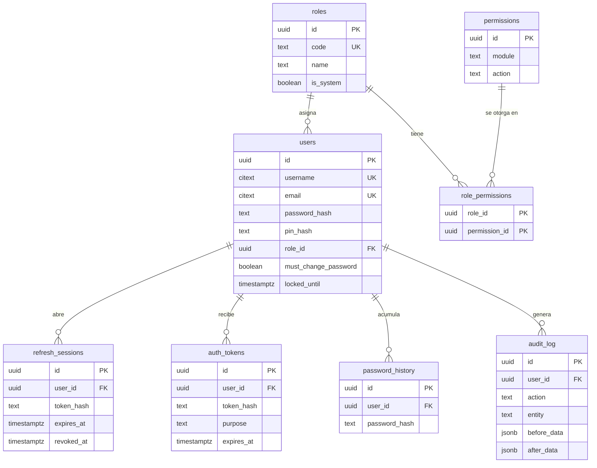
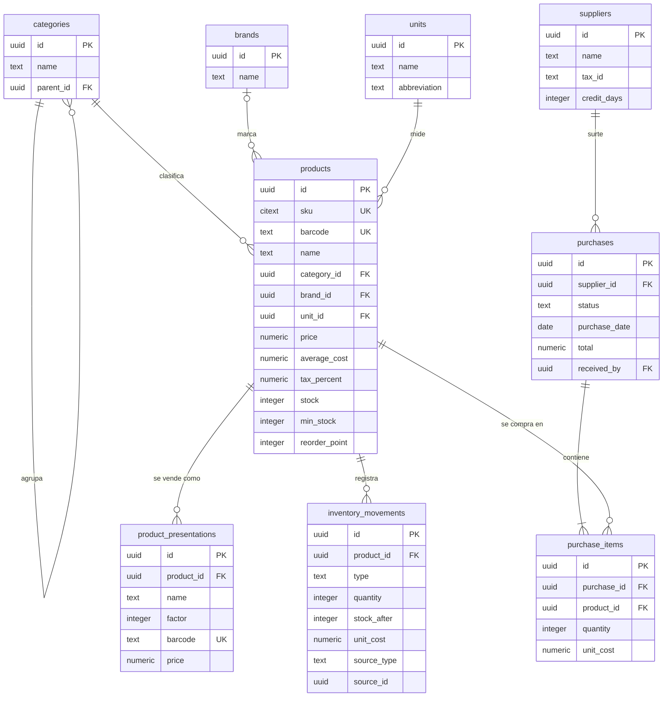
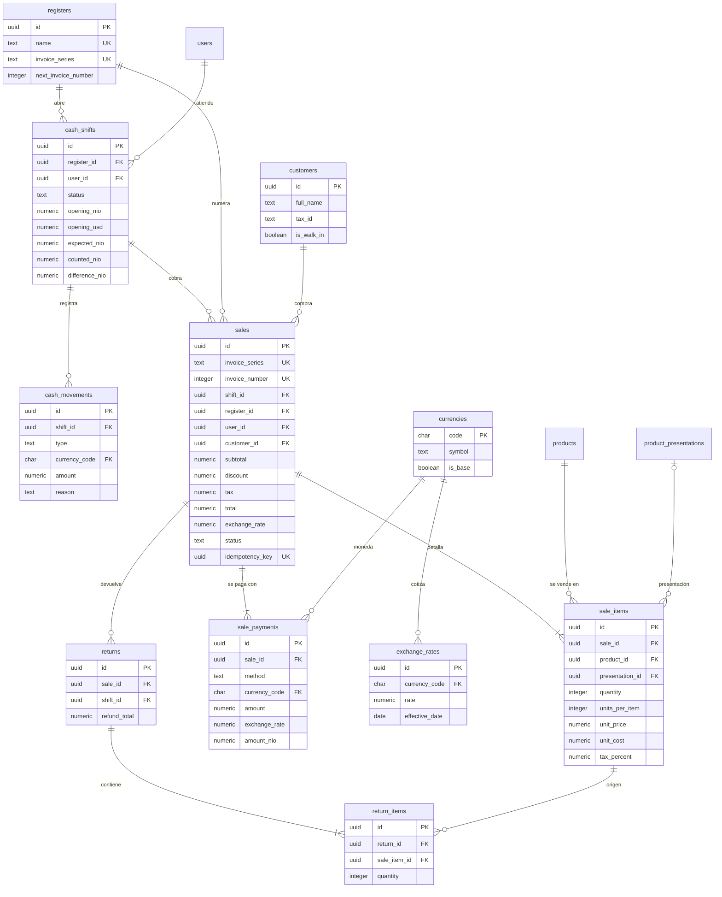
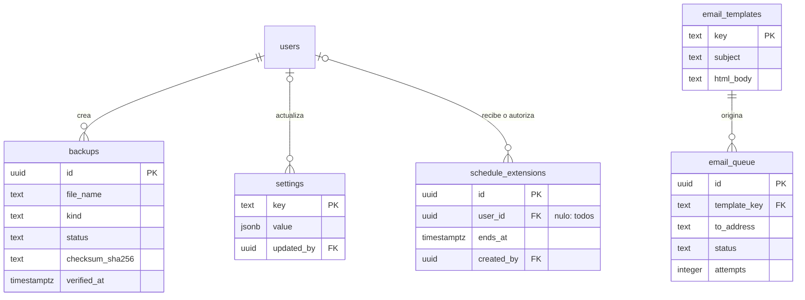

# Diagrama entidad-relación

Base de datos PostgreSQL 16 con 33 tablas, creadas por las migraciones de `apps/api/migrations`. El modelo se divide por dominio para que cada diagrama se pueda leer; las tablas que se repiten son el punto de unión entre dominios. Solo se muestran las columnas clave.

Decisiones de diseño:

- **El stock es un resultado.** `products.stock` lo actualiza un trigger al insertar en `inventory_movements`, y ese kardex no admite `UPDATE` ni `DELETE`.
- **La venta guarda una foto.** `sales` y `sale_items` copian nombre, precio, costo e IVA del momento, para que cambiar el catálogo no altere facturas pasadas.
- **Todo monto en córdobas.** Cada pago conserva su moneda original, la tasa usada y el equivalente en `amount_nio`.
- **La bitácora es de solo agregar.** Un trigger impide modificar o borrar `audit_log`.

## Seguridad y usuarios

## Catálogo e inventario

## Caja y ventas

Las tablas `returns` y `return_items` existen en el esquema, pero el sistema no registra devoluciones: quedaron fuera del alcance de esta versión.

## Sistema

